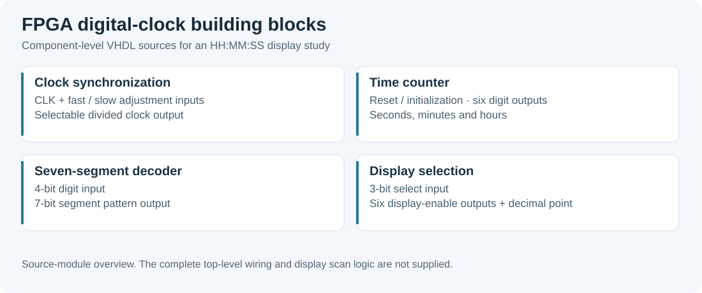

# FPGA Digital Design

VHDL laboratory material for a multiplexed digital clock, digital-logic laboratory reports and original FPGA project archives.

*Technical study overview based on the available repository material.*

## Repository guide

- [Horloge_numerique_FPGA](Horloge_numerique_FPGA/): clock modules, display decoding and Nexys A7 constraints.
- [archive/ise_projects](archive/ise_projects/): historical Xilinx ISE work, preserved with its original internal layout.

The **FM tuning controller** now has its own canonical repository: [Minuterie_FPGA](https://github.com/tedjelmoulksn-dotcom/Minuterie_FPGA). Its maintained sources, diagrams and report are located there.

## Digital-logic reports

| Report | Technical content |
| --- | --- |
| [Digital electronics TP0/TP1](docs/digital_electronics_tp0_tp1_report.pdf) | PLD/FPGA introduction, pulse counting and down-counting, BCD-to-seven-segment decoding, schematic symbols, simulation, synthesis and constraint-file workflow |
| [Decimal/BCD code conversion](docs/decimal_bcd_code_conversion_report.pdf) | Decimal-to-BCD encoding and BCD-to-decimal decoding, truth tables, Boolean output equations and gate diagrams |

The code-conversion report is a combinational-logic study, providing foundations for the repository's display decoding. Its 10-to-4 encoder assumes exactly one active decimal input; the OR equations do not implement a priority encoder. The report's later references to multimedia transcoding concern a different meaning of the term and do not describe these logic circuits.

The TP0/TP1 report names a Nexys A7 while describing a legacy schematic/UCF workflow. Read it as the original classroom procedure; the current clock's board constraints are the XDC files in its module. The document supplements the source collection without establishing that every historical project targets the same device.

Original reports remain in French and retain their coauthor credits.

## Working with the clock

Read the module guide, inspect the VHDL sources and match the XDC constraints to your board. The clock study uses Vivado-style constraints; archived ISE projects belong to an older toolchain.

The available modules do not establish a newly validated complete board-level build. Check top-level integration, clocking and display timing before synthesis.
